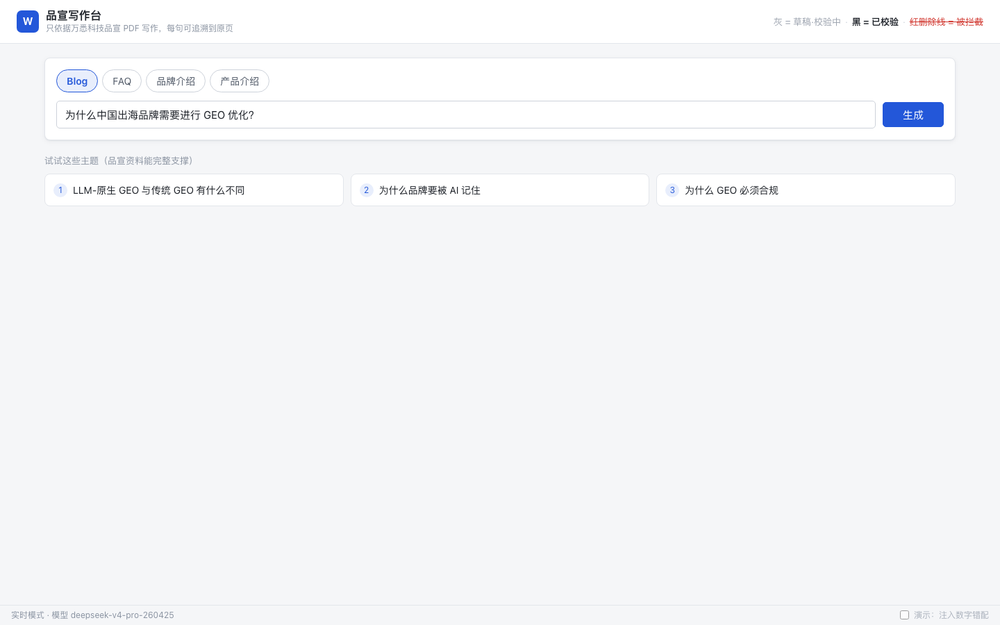
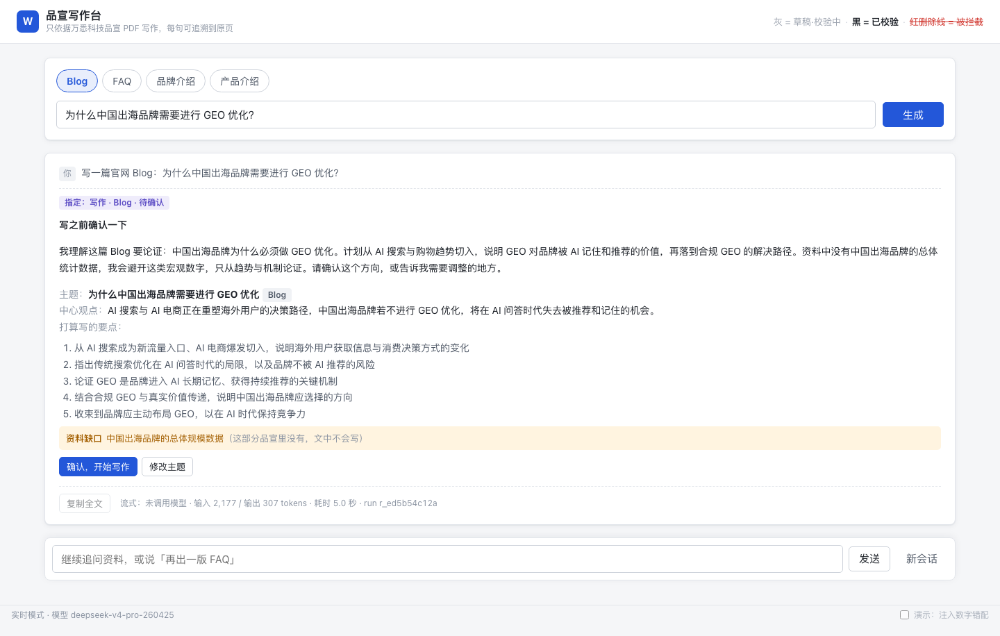
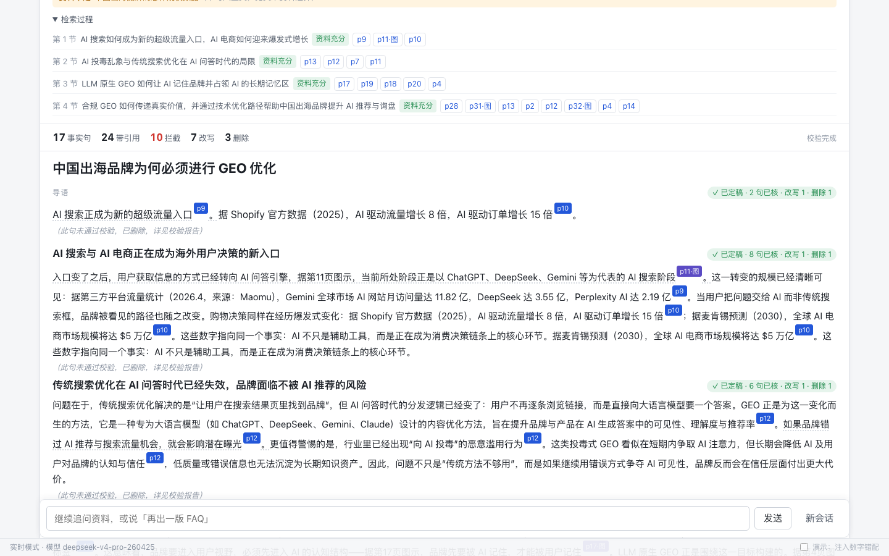
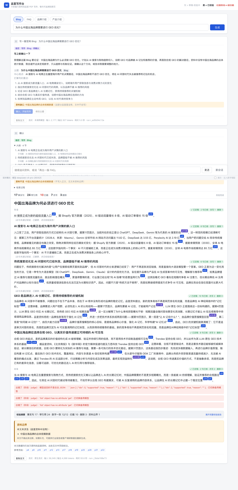
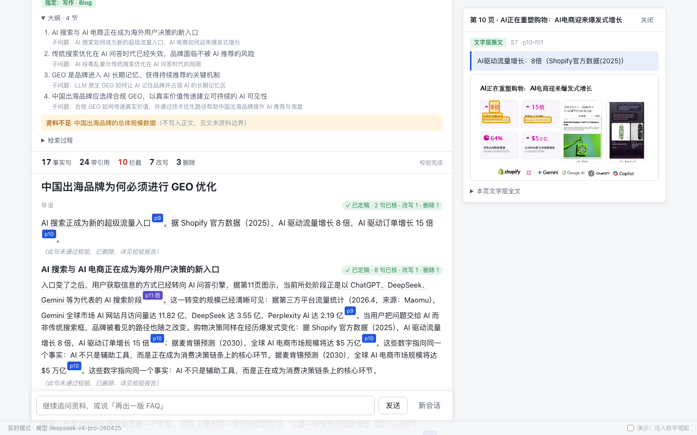
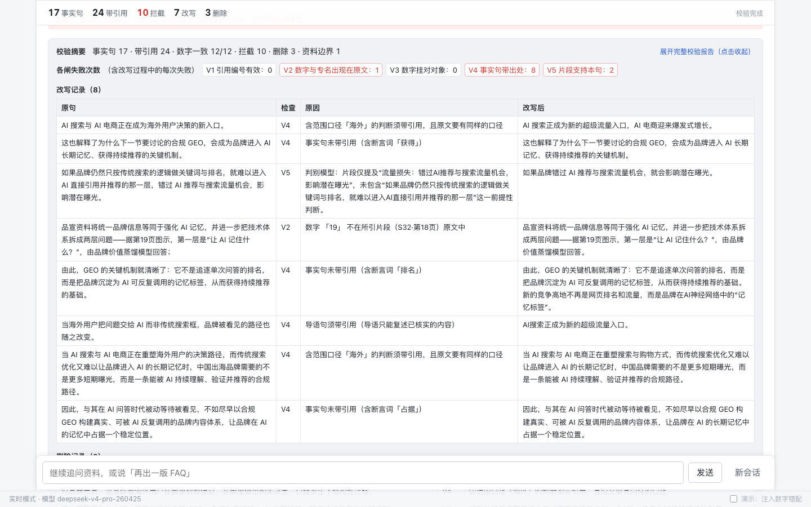
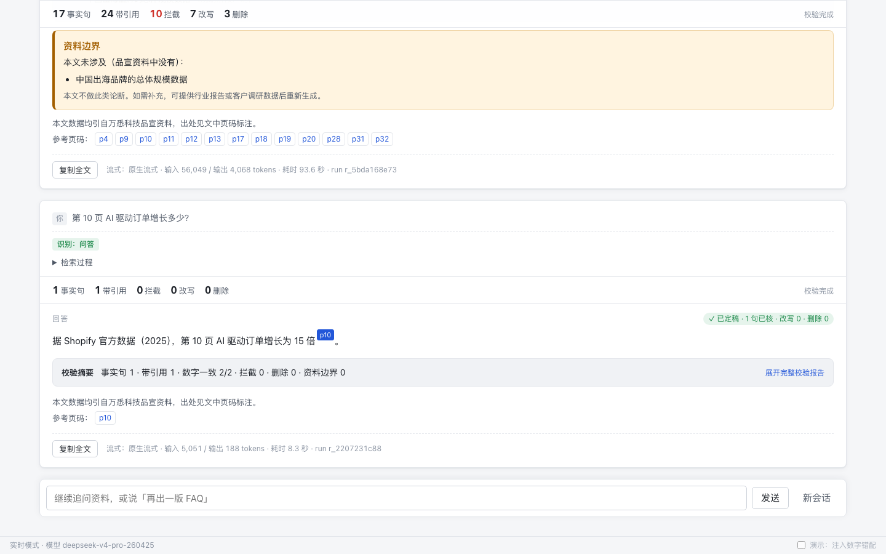
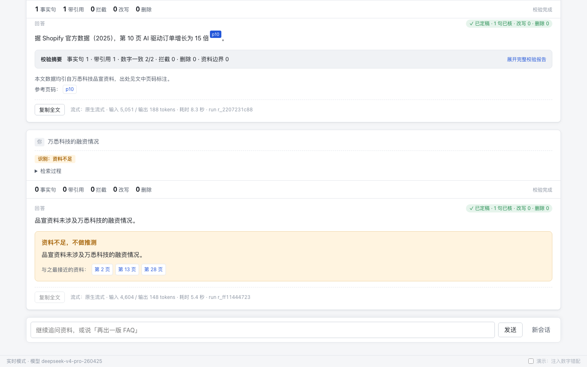
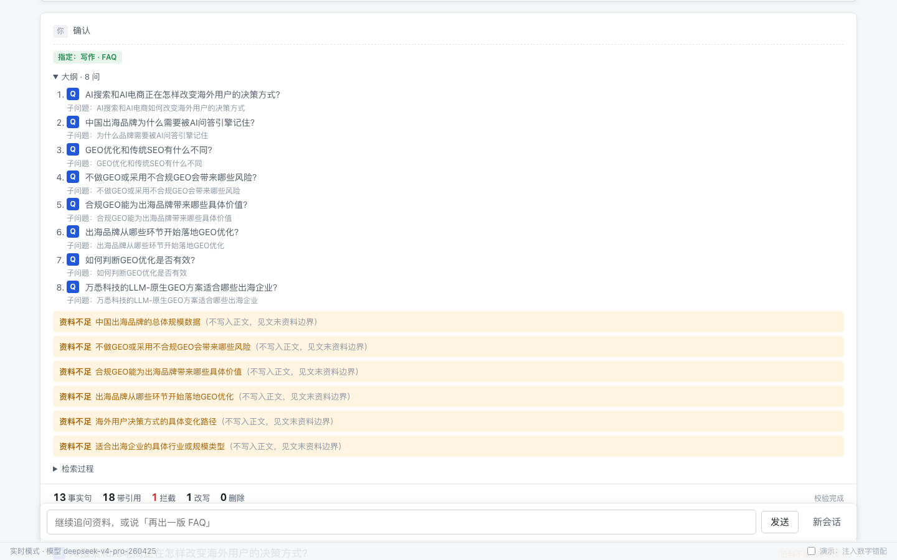

# 运行成果展示

> 本页用真实运行截图，逐条对应题面「AI 工程：基于 RAG 的品牌内容写作系统」的要求。
> 截图时间 2026-10-24 10:20–10:35 · 实时模式（非回放）· 生成模型 `deepseek-v4-pro` · 页面 `web/`，后端 `uvicorn ragwriter.api.app:app`
> 全部截图在 [`screenshots/`](screenshots/)。同一个会话里依次完成：Blog → 单点问答 → 拒答 → 再出一版 FAQ。

## 题面要求 → 在哪里看

| 题面要求 | 截图 | 代码 / 文档 |
|---|---|---|
| 读取 PDF → 解析与切分 | — | [`src/ragwriter/ingest/`](src/ragwriter/ingest/) · [`src/ragwriter/chunk/`](src/ragwriter/chunk/) · [语料解析报告](docs/corpus-report.md) |
| 建立检索索引 | — | [`src/ragwriter/index/`](src/ragwriter/index/)（SQLite 单文件：FTS5 BM25 + 向量） |
| 输入主题 → 检索资料 | [③ 检索过程](#3--检索按小节混合检索每节判断资料是否充分) | [`src/ragwriter/retrieve/`](src/ragwriter/retrieve/) |
| 构建上下文 → 生成内容 | [② 写作前确认](#2--写作前确认先对齐理解再花模型调用) · [④ 成稿](#4--成稿标题--导语--小标题--结尾每句带页码) | [`src/ragwriter/generate/`](src/ragwriter/generate/) |
| 标题、导语、小标题、结尾；FAQ 可选 | [④ 成稿](#4--成稿标题--导语--小标题--结尾每句带页码) · [⑨ FAQ](#9--faq同一主题换体裁) | [`prompts/genres/`](prompts/genres/) |
| 展示所依据的 PDF 片段或页码 | [⑤ 引用面板](#5--引用溯源点页码看原页与原文) | [`src/ragwriter/verify/`](src/ragwriter/verify/) |
| 不得编造 | [⑥ 校验报告](#6--幻觉控制每句过校验闸拦下的逐条可查) | [`src/ragwriter/verify/checks.py`](src/ragwriter/verify/checks.py) |
| 资料不足时明确处理 | [⑧ 拒答](#8--资料不足明说没有不猜) · ④ 文末「资料边界」 | [`src/ragwriter/agent/handlers/refuse.py`](src/ragwriter/agent/handlers/refuse.py) |
| 完整 Prompt | — | [`prompts/`](prompts/)（原文，不删减） |
| 示例输出 | — | [`samples/`](samples/) |
| 可运行 Demo | 本页全部 | `make demo` |

---

## 1 · 首页



选体裁（Blog / FAQ / 品牌介绍 / 产品介绍），输入主题。页面顶部是图例：灰色是草稿（校验中），黑色是已校验，红色删除线是被拦截的句子。

## 2 · 写作前确认：先对齐理解，再花模型调用



输入题目给的示例主题。系统先只看页标题目录，判断资料能不能写，然后给出中心观点、打算写的要点，以及**资料缺口**（「中国出海品牌的总体规模数据」品宣里没有，文中不会写）。用户确认后才开始检索和写作。

## 3 · 检索：按小节混合检索，每节判断资料是否充分



大纲拆成 4 节，每节一个子问题，分别跑 BM25 和向量检索，再用 RRF 合并。每节都标出「资料充分」和命中的页码，带「·图」的是来自页面图示的结构化内容（如 `p11·图`、`p31·图`）。

## 4 · 成稿：标题 + 导语 + 小标题 + 结尾，每句带页码



一篇完整的官网 Blog。顶部统计：**17 个事实句、24 处引用、拦截 10 次、改写 7 句、删除 3 句**。文末有「资料边界」（本文没写什么、为什么没写）和参考页码。

本次耗时 93.6 秒，输入 56,049 tokens，输出 4,068 tokens。

## 5 · 引用溯源：点页码看原页与原文



点正文里的 `p10`，右侧显示第 10 页原页图，以及这句话所引的文字层原文：「AI驱动流量增长：8倍（Shopify官方数据(2025)）」。引用编号由程序发给模型，模型只能引用上下文里存在的编号，程序再映射回页码和原文。

## 6 · 幻觉控制：每句过校验闸，拦下的逐条可查



展开完整校验报告，可以看到每道闸的失败次数和每一条改写记录（原句、拦下它的检查、原因、改写后）。例如：

| 原句 | 检查 | 原因 |
|---|---|---|
| AI 搜索与 AI 电商正在成为**海外**用户决策的新入口 | V4 | 「海外」这个范围口径，原文里没有 |
| ……把技术体系拆成两层问题——据第**19**页图示…… | V2 | 数字「19」不在所引片段（第 18 页）原文中 |
| 如果品牌仍然只按传统搜索的逻辑做关键词与排名…… | V5 | 判别模型：片段不支持这一前提性判断 |

V1–V4 是确定性规则（引用编号存在、数字与专名能在原文找到、数字挂对对象、事实句必须带引用），V5 是模型判别。本篇数字一致率为 12/12。

## 7 · 单点问答



同一会话里追问「第 10 页 AI 驱动订单增长多少？」。答「15 倍」，引用第 10 页，用时 8.3 秒。

## 8 · 资料不足：明说没有，不猜



问「万悉科技的融资情况」。品宣里没有这部分内容，系统回答「品宣资料未涉及」，并给出最接近的第 2、13、28 页，用时 5.4 秒。

## 9 · FAQ：同一主题换体裁



说「再出一版 FAQ」。系统沿用上一篇的主题，同样先确认，再写 8 问。资料撑不起来的问题在大纲阶段就标为「资料不足」，不写进正文。本次耗时 55.1 秒，并附带 FAQPage 的 JSON-LD 结构化数据。

---

## 本次运行暴露的问题（如实记录）

| 问题 | 影响 | 状态 |
|---|---|---|
| V5 判别模型的输出解析失败：中转下模型返回了用 ```json 包起来的数组，而不是约定的 `{"items": [...]}`。页面上显示为「出错了（阶段：judge）」 | Blog 有 3 节、FAQ 有 3 处 V5 判别被跳过，其中一处判别结果本来是「不支持」，被一起丢掉了。V1–V4 确定性校验不受影响 | 修复中（`llm/client.py` 剥代码块标记，`handlers/__init__.py` 兼容数组），尚未提交 |
| Blog 第一节和第三节各有一句被重复写了两遍 | 读感差，事实本身仍有引用 | 待查 |
| FAQ 8 问里有 3 问在写作阶段被判为资料不足（如「合规 GEO 能带来哪些具体价值」），而第 13、14 页其实有相关内容 | FAQ 偏短 | 待查充分性判断 |
